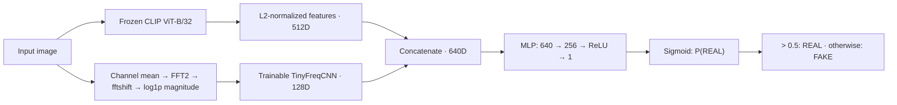

# CLIP-Frequency Fusion for AI-Generated Image Detection

*Experiments on CIFAKE with robustness analysis*

A lightweight AI-generated image detector that combines frozen CLIP semantic features with frequency-domain forensic features, with systematic robustness analysis under JPEG compression, Gaussian noise, and Gaussian blur.

基于 CIFAKE 的小规模图像真假检测实验，比较 CLIP 语义特征、频域特征及二者融合，并评估 JPEG 压缩、高斯噪声与高斯模糊下的性能变化。

## 项目动机

图像语义表示与频谱信息可能提供互补的真假识别线索。本项目研究两个问题：加入一个轻量频域分支能否改善 clean 图像上的分类表现，以及这种收益能否在常见图像退化后保留。目标是记录可追溯的基线比较与失败现象。

## 方法

- **CLIP + Linear**：冻结的 `openai/clip-vit-base-patch32` 图像特征，经 L2 归一化后输入 `Linear(512, 1)`。
- **CLIP + MLP**：相同的 512 维特征，分类头为 `512 → 256 → ReLU → 1`。
- **Frequency-only**：图像通道均值转灰度，依次执行二维 FFT、fftshift、幅度与 log1p；TinyFreqCNN 使用两层卷积（1→16→32）、ReLU、池化和全局平均池化，再映射到 128 维，以线性层二分类。
- **CLIP + Frequency Fusion**：拼接 512 维 CLIP 特征与 128 维频域表示，输入 `640 → 256 → ReLU → 1` 分类头。CLIP 特征离线提取；频域分支与分类头参与训练。

Fusion pipeline（CLIP 特征离线提取；频域编码器与分类头参与训练）：



正式实验使用类别均衡的 **1000 个训练样本、200 个测试样本**。aligned 特征抽样 seed 为 42，样本索引随仓库保留。训练使用 batch size 64、100 epochs、Adam、学习率 0.001 与 BCEWithLogitsLoss。多 seed 实验使用 `[42, 123, 2026]`，固定数据子集，仅改变训练随机种子。

标签是 **0=FAKE、1=REAL**；预测规则为 `sigmoid(logit) > 0.5`。当前 Precision、Recall、F1 的正类为 **REAL**，AUC 也使用 REAL 的预测概率。多 seed 表格的标准差使用 NumPy 默认总体标准差（ddof=0）。

## 主结果

以下均为整理前已有的实验记录，本次工程整理没有重新训练。来源：[原始结果表](results/experiment_results.csv)。指标以百分数表示。

| 单 seed 实验（seed=42） | Accuracy | F1 | AUC |
|---|---:|---:|---:|
| CLIP + Linear aligned | 85.50 | 85.85 | 92.83 |
| CLIP + MLP aligned | 90.00 | 90.10 | 96.97 |
| Frequency-only v1 | 79.00 | 80.19 | 87.80 |
| Fusion v1 | 91.50 | 91.71 | 98.33 |

| 多 seed 实验（均值 ± 标准差） | Accuracy | F1 | AUC |
|---|---:|---:|---:|
| CLIP + MLP aligned | 89.83 ± 0.24 | 89.95 ± 0.36 | 96.98 ± 0.01 |
| Fusion aligned | 90.67 ± 0.24 | 90.76 ± 0.24 | 97.97 ± 0.02 |

> **Takeaway:** On the fixed CIFAKE subset, Fusion improves clean Accuracy by 0.83 pp and AUC by 0.99 pp over CLIP+MLP, but its Accuracy advantage does not persist under severe noise and blur.

差值按多 seed 结果的未四舍五入数据计算。这不构成统计显著性或跨数据集泛化结论；强噪声下 AUC 与固定阈值分类指标的表现也不完全一致，详见 Failure analysis。

`fusion_v1` 的 seed=42 结果与多 seed 脚本中的 seed=42 不完全一致：单 seed 脚本在模型初始化前会取一个训练 batch，改变随机数消耗顺序。该执行差异原样保留，不能将两个结果视为同一次运行。

## Robustness

所有鲁棒性实验均在 **clean 训练集上训练**，然后用同一模型测试 clean 与四档退化条件，不进行扰动训练或测试时微调。每个鲁棒性脚本独立执行三个训练 seed。

- JPEG quality：`90, 70, 50, 30`。
- Gaussian noise sigma：`5, 10, 20, 30`，作用于 0–255 像素尺度；按测试子集中的样本位置设置噪声 seed，两个分支保持对应。
- Gaussian blur radius：`0.5, 1.0, 1.5, 2.0`，使用 PIL GaussianBlur。
- Fusion 的两条分支都对应同一退化条件：CLIP 读取离线缓存，频域分支在相应退化图像上计算频谱。

下表为三个 seed 的 Accuracy（%，均值 ± 标准差），包括全部退化档位：

| 测试条件 | CLIP + MLP | Fusion |
|---|---:|---:|
| clean | 89.83 ± 0.24 | 90.67 ± 0.24 |
| jpeg_q90 | 89.17 ± 0.47 | 90.83 ± 0.62 |
| jpeg_q70 | 90.50 ± 0.00 | 90.67 ± 0.24 |
| jpeg_q50 | 88.33 ± 0.24 | 89.33 ± 0.62 |
| jpeg_q30 | 84.00 ± 0.71 | 79.83 ± 0.62 |
| noise_sigma5 | 85.00 ± 0.71 | 88.33 ± 0.94 |
| noise_sigma10 | 86.17 ± 0.24 | 86.50 ± 0.41 |
| noise_sigma20 | 74.33 ± 1.18 | 72.67 ± 2.25 |
| noise_sigma30 | 64.83 ± 0.85 | 56.83 ± 0.94 |
| blur_radius0.5 | 85.83 ± 0.24 | 82.67 ± 0.62 |
| blur_radius1.0 | 78.00 ± 0.41 | 56.33 ± 0.24 |
| blur_radius1.5 | 72.33 ± 0.24 | 53.67 ± 0.62 |
| blur_radius2.0 | 69.83 ± 0.24 | 52.50 ± 0.41 |

结果来源：CLIP+MLP 的 [JPEG](results/jpeg_robustness_results.csv)、[Noise](results/noise_robustness_results.csv)、[Blur](results/clip_mlp_blur_robustness_results.csv)，以及 Fusion 的 [JPEG](results/fusion_jpeg_robustness_results.csv)、[Noise](results/fusion_noise_robustness_results.csv)、[Blur](results/fusion_blur_robustness_results.csv)。CSV 还包含 Precision、Recall、F1 和 AUC。

## Failure analysis

**强模糊下，Fusion 的 clean 优势没有保留。** radius=2.0 时，Fusion Accuracy 为 52.50%，相对 clean 下降 38.17 个百分点；CLIP+MLP 为 69.83%，下降 20.00 个百分点。Fusion AUC 同时降至 57.18%，说明退化不仅体现在固定阈值上的分类结果。频域线索可能对模糊敏感，但现有结果不能单独证明具体因果机制。`debug/diagnose_blur_spectrum_stats.py` 可检查频谱统计量；目前仓库没有保存该诊断的输出，也没有分支消融来验证这一解释。

**强噪声下，需要同时看阈值指标与排序指标。** sigma=30 时，Fusion Accuracy 为 56.83%、REAL Recall 为 18.00%、F1 为 29.39%，但 AUC 为 75.76%；CLIP+MLP AUC 为 73.36%。这与 Fusion 在固定阈值下更倾向预测 FAKE 的现象一致，不能仅用 AUC 判断其分类表现更好。本项目保留原始 0.5 阈值，没有进行阈值调优。

**JPEG 表现并非单调下降。** 例如 CLIP+MLP 在 q70 的平均 Accuracy 略高于 clean，但 q30 时下降到 84.00%；Fusion 在 q30 为 79.83%。这些是当前小测试集上的观测，不代表压缩普遍有益。

## Limitations

- 仅使用 CIFAKE 的 1000/200 平衡子集；未覆盖完整数据集、其他生成器或真实部署分布。
- 多 seed 只改变训练随机性，未重复抽样划分；标准差不是数据划分不确定性，也不是置信区间。
- 正式 CLIP+Linear 与 Frequency-only 只有单 seed 记录；鲁棒性比较仅覆盖 CLIP+MLP 和 Fusion。
- 没有独立验证集上的阈值校准、显著性检验或已保存的逐图像错误分析。本次不增加这些实验。
- 历史依赖版本、Hugging Face 数据集/模型 revision 和模型权重未完整记录。依赖清单仅列直接依赖，无法据此保证不同环境逐位复现。
- 部分脚本在导入时直接运行训练或特征提取；当前作为独立实验入口使用。日志覆盖与 CSV 追加/覆盖行为保留，重跑前应备份已有输出。
- legacy 实验使用不同采样与训练流程，不能直接混入正式实验汇总。

## 工程结构

```text
scripts/extract/      aligned clean 与扰动 CLIP 特征提取
scripts/baselines/    正式 Linear、MLP、Frequency-only
scripts/fusion/       正式 Fusion 单 seed / 多 seed
scripts/robustness/   CLIP+MLP 与 Fusion 的 JPEG / Noise / Blur
legacy/               早期 small_* 特征与全批量训练脚本
debug/                CLIP 演示、FFT 可视化、频谱诊断
features/             固定索引与本地特征缓存
results/              原始实验 CSV 与本地日志
data/                 本地参考素材，不是 CIFAKE 数据集目录
docs/                 实验对应关系与复现步骤
```

所有本地输入输出均相对于脚本定位到的项目根目录解析，不依赖个人电脑路径或启动时所在目录。缓存和本地素材保留在磁盘，通过 `.gitignore` 排除；两个样本索引及已有结果 CSV 保留版本追踪。

## 运行与复现

先阅读 [实验对应表](docs/experiments.md) 与 [复现说明](docs/reproduction.md)。以下命令从项目根目录运行：

```bash
python -m venv .venv
source .venv/bin/activate
python -m pip install -r requirements.txt
```

下面以 **clean 对比 → Fusion blur robustness** 为一条完整主流程。首次提取需要下载 Hugging Face 数据集和 CLIP 模型。clean 提取会重写索引和特征文件：先按[复现说明](docs/reproduction.md#数据和索引)备份索引，提取后确认索引一致，再继续训练；已有匹配缓存时跳过相应提取步骤。重跑前也应备份需要保留的结果 CSV 和日志。

```bash
# 1. 提取 aligned clean 特征；完成后先核对已备份的 indices
python scripts/extract/extract_clip_features_aligned.py

# 2. 在同一固定子集上运行两个 multi-seed clean 实验
python scripts/baselines/clip_mlp_multiseed_aligned.py
python scripts/fusion/fusion_multiseed_aligned.py

# 3. 生成 blur 测试缓存，再运行 Fusion blur 鲁棒性实验
python scripts/extract/extract_blur_clip_features.py
python scripts/robustness/fusion_blur_robustness.py
```

最后一个脚本会独立重新训练三个 seed，并评估 clean 与四档 blur；它不读取前一个 Fusion 实验的模型权重。JPEG、Noise 及 CLIP+MLP 鲁棒性的完整命令见[复现说明](docs/reproduction.md#鲁棒性实验)。本次文档更新没有执行上述实验。
